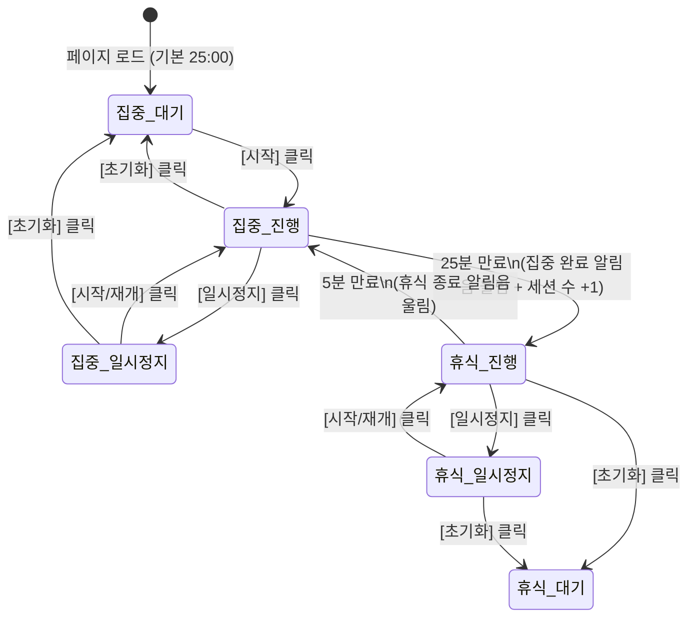

# 🍅 포모도로 타이머 (Pomodoro Flow) 프로젝트 개요 및 기능명세서

---

## 1. 프로젝트 개요 (Project Overview)

- **프로젝트 명**: 포모도로 플로우 (Pomodoro Flow) 웹 애플리케이션
- **프로젝트 목적**: 
  - 25분 집중과 5분 휴식 주기를 자동으로 순환하여 업무 및 학업 생산성을 극대화하는 반응형 웹 타이머입니다.
  - 시각적 진행률 피드백, 백색소음 및 알림음, 직관적인 테마 전환을 제공하여 별도의 설치 없이 브라우저에서 편리하게 사용할 수 있습니다.
- **주요 기술 스택**:
  - **Front-end**: HTML5, Modern CSS3 (Flexbox/Grid, CSS Variables, SVG Animation), Vanilla JavaScript (ES6+)
  - **Audio API**: Web Audio API (합성 알림음) 및 HTML5 Audio Element (백색소음 무한 루프)
  - **배포 형태**: 단일 페이지 웹 애플리케이션 (SPA)

---

## 2. 시스템 상태 및 동작 흐름 (State Workflow)



---

## 3. UI 화면 레이아웃 구성안 (Wireframe)

```
+-------------------------------------------------------------+
|  [🍅 Pomodoro Flow]                           [세션: 🍅 x 3] |
+-------------------------------------------------------------+
|                                                             |
|                       [ FOCUS MODE ]                        |
|                                                             |
|                    . - ~ ~ ~ - .                            |
|                .-'               '-.                        |
|              /                       \                      |
|             |          24:59          |  <-- 원형 진행 링   |
|              \                       /       (SVG Progress) |
|                '-.               .-'                        |
|                    ' - ~ ~ ~ - '                            |
|                                                             |
|             [ 시작 ]    [ 일시정지 ]    [ 초기화 ]            |
|                                                             |
|  ---------------------------------------------------------  |
|  [ 백색소음 (Ambient Sound) ]                                |
|  ( ) 끄기   (•) 🌊 파도   ( ) 🌧️ 비   ( ) 🐦 새소리          |
|  [🔊 음소거]  [======●===========] 60%                      |
|                                                             |
+-------------------------------------------------------------+
```

---

## 4. 요구사항별 상세 기능명세서 (Functional Specification)

### [기능 1] 25분 집중, 5분 휴식 세트 자동 전환
- **시간 설정**:
  - **집중 시간(Focus Mode)**: 25분 (1,500초)
  - **휴식 시간(Rest Mode)**: 5분 (300초)
- **자동 전환 로직**:
  - 집중 25분이 끝나 `00:00`에 도달하면 알림음이 울리고, 즉시 5분 휴식 모드로 자동 전환되어 타이머가 연속 진행됩니다.
  - 휴식 5분이 끝나 `00:00`에 도달하면 알림음이 울리고, 다시 25분 집중 모드로 자동 전환되어 타이머가 연속 진행됩니다.

### [기능 2] 타이머 조작 버튼 (시작, 일시정지, 초기화)
- **시작 (Start)**: 카운트다운을 시작합니다.
- **일시정지 (Pause)**: 현재 남은 시간을 유지한 채 일시 정지합니다.
- **초기화 (Reset)**: 현재 모드(집중 또는 휴식)의 초기 설정 시간(25:00 또는 05:00)으로 타이머를 되돌리고 정지 상태로 전환합니다.
- **타이머 정밀도 보정**: 백그라운드 탭 비활성화 시의 타이머 드리프트(Timer Throttling)를 방지하기 위해 `Date.now()` 기반 경과 시간 동기화 적용.

### [기능 3] 백색소음 시스템 (파도, 비, 새소리 + 볼륨 & 음소거)
- **음원 종류**:
  - 🌊 **파도 소리 (Waves)**: 규칙적이고 차분한 해변 파도 소리
  - 🌧️ **빗소리 (Rain)**: 창가에 내리는 지속적인 빗소리
  - 🐦 **새소리 (Birds)**: 숲속의 맑고 잔잔한 새 지저귐
- **재생 컨트롤**:
  - 라디오 버튼/선택 카드를 통해 원하는 소리를 1종 선택하거나 소리를 끌 수 있는 `끄기(Off)` 옵션 제공
  - 끊김 없는 무한 루프(`loop`) 재생
- **음량 조절 및 음소거**:
  - 슬라이더 인터페이스를 통한 부드러운 볼륨 조절 (0% ~ 100%)
  - 원클릭 음소거(Mute) 토글 버튼 제공 (음소거 시 볼륨 값은 기억하고 아이콘 🔊 ➔ 🔇 변환)

### [기능 4] 중앙 대형 시간 표시 및 원형 진행 링 (Circular Progress Ring)
- **중앙 시간 표시**:
  - 고가독성 모노스페이스 계열 폰트로 `MM:SS` 형식 대형 출력 (예: `24:59`)
  - 현재 상태 배지(`FOCUS` / `REST`)를 상단에 직관적으로 배치
- **원형 진행 링 (SVG Ring)**:
  - SVG `<circle>`의 `stroke-dasharray`, `stroke-dashoffset` 속성을 활용하여 진행률 시각화
  - 시간 경과에 따라 진행 링이 시계 방향으로 부드럽게 소진/충전되는 애니메이션 구현
  - 모드(집중/휴식)에 맞는 테마 색상으로 링 색상 자동 변경

### [기능 5] 브라우저 탭 제목(Title) 실시간 연동
- **동작 규칙**:
  - 사용자가 다른 탭에서 작업 중일 때도 남은 시간을 확인할 수 있도록 `document.title`을 실시간 업데이트
  - **집중 진행 시**: `[24:59] 집중 중 🎯 | Pomodoro`
  - **휴식 진행 시**: `[04:30] 휴식 중 ☕ | Pomodoro`
  - **일시정지 시**: `[일시정지] 24:59 | Pomodoro`
  - **세션 종료 시**: `[완료!] 모드 전환 알림` 깜빡임 효과

### [기능 6] 모드 완료 알림음(Alarm)
- **알람 사운드 구분**:
  - **집중 세션 종료 (25분 만료)**: 성취감을 주는 맑은 종소리/차임벨(Chime) 사운드
  - **휴식 세션 종료 (5분 만료)**: 리프레시 후 집중 복귀를 알리는 경쾌한 시작 알림
- **구현 방식**:
  - 네트워크 연결이나 외부 링크 깨짐 위험이 없는 브라우저 기본 **Web Audio API 오디오 합성**(신시사이저 주파수 기반 차임벨) 및 오픈소스 사운드 링크 병행 지원
  - 브라우저 자동 재생 정책(Autoplay Policy) 준수를 위해 첫 버튼 클릭 인터랙션 시 AudioContext 활성화

### [기능 7] 세션 카운터 (Session Counter)
- **카운트 조건**:
  - 25분 집중 세션이 정상적으로 완료되어 휴식으로 전환될 때마다 카운트 `+1` 증가 (중도 초기화 시 증가하지 않음)
- **표시 형태**:
  - 화면 상단에 `완료 세션: 🍅 x 3` 형태로 직관적인 배지 표시
  - 세션 초기화 버튼 제공 및 브라우저 새로고침 시에도 유지되도록 `localStorage` 저장 지원

### [기능 8] 모드별 동적 배경색 전환
- **테마 색상 팔레트**:
  - **집중 모드 (Focus)**: 따뜻하고 차분한 테라코타/버건디 레드 톤 (예: `#BA4949`)
  - **휴식 모드 (Rest)**: 편안하고 이완을 주는 세이지 그린/틸 톤 (예: `#38858A`)
- **트랜지션 효과**:
  - `transition: background-color 0.8s ease`를 적용하여 모드 전환 시 배경과 주요 UI 요소 색상이 부드럽게 페이드 전환

### [기능 9] 둥근 모서리 버튼 및 Hover 애니메이션
- **버튼 스타일**:
  - 둥근 알약형 스타일(`border-radius: 9999px` 또는 `16px`)
  - 반투명 글래스모피즘(Glassmorphism) 및 부드러운 드롭 섀도우 적용
- **인터랙션 효과**:
  - **Hover (마우스 오버)**: 위로 살짝 떠오르는 모션(`transform: translateY(-2px)`), 그림자 확대 및 배경 밝기 조절
  - **Active (클릭 시)**: 살짝 눌리는 물리적 피드백(`transform: scale(0.97)`)
  - 자연스러운 반응 속도(`transition: all 0.2s cubic-bezier(0.4, 0, 0.2, 1)`)

---

## 5. 프로젝트 파일 구조 제안

```
📁 프로젝트10_20261018/8주차_02교시/
├── project_specification.md   # 본 프로젝트 개요 및 기능명세서
├── index.html                 # 메인 화면 구조 및 SVG 타이머 레이아웃
├── style.css                  # 모드별 테마 색상, 링 애니메이션, 버튼 인터랙션
└── script.js                  # 타이머 엔진, Web Audio API, 백색소음 제어 로직
```
